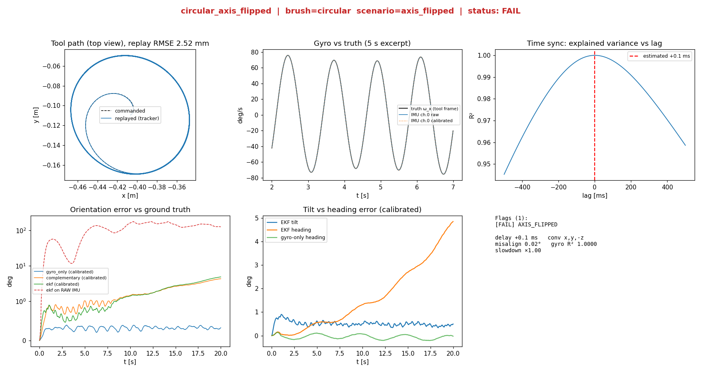
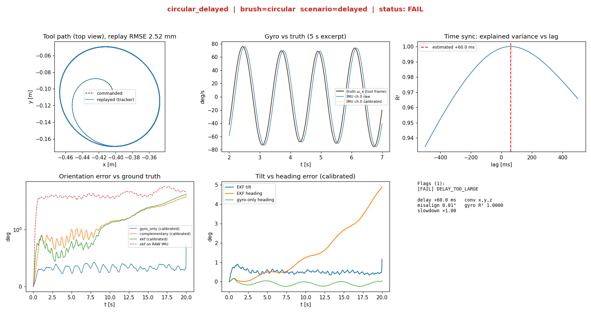

# imulab — Virtual IMU Validation Lab

**A simulated version of the "replay a motion, compare an IMU against motion capture" workflow.**
A 6-DOF robot arm replays brushing-like trajectories while a *virtual IMU* (with injectable faults) and a *ground-truth tracker* measure it. The software then checks how well the IMU matches the true motion, estimates what is wrong with it, fixes it, and raises diagnostic flags.

No hardware needed. One command to run everything.


)

## Why this exists

Real IMU pipelines fail in boring ways: a flipped axis, a 60 ms delay, a drifting bias, a sensor mounted off the tracked point. These are hard to debug on hardware because you never know the true answer. In simulation you do, so you can inject each fault, measure how well the tools recover it, and see what it does to orientation estimation.

## What it does

| Stage | What | Module |
|---|---|---|
| Simulation | UR5-like 6-DOF arm, 4 brush motions (circular, sweep, scrub, mixed) at 120 Hz, kinematic or PyBullet dynamic replay | `arm.py`, `trajectory.py`, `sim.py`, `pybullet_backend.py` |
| Virtual sensors | IMU with axis convention, mounting misalignment, scale, bias + random walk, noise, low-pass filter, delay, lever arm. Ground-truth tracker | `sensors.py`, `scenarios.py` |
| Trajectory pipeline | Quaternion poses → IK → joint position/speed/acceleration checks → automatic slow-down | `pipeline.py` |
| Validation | Delay estimation, frame/scale/bias calibration, replay accuracy, repeatability, brush similarity | `calibration.py`, `metrics.py` |
| Fusion | Gyro dead-reckoning, Mahony-style complementary filter, error-state EKF | `fusion.py` |
| Diagnostics + dashboard | Automatic flags (`DELAY_TOO_LARGE`, `AXIS_FLIPPED`, `GYRO_BIAS_HIGH`, …) and a Streamlit app | `diagnostics.py`, `dashboard/app.py` |

```
trajectory → IK + limit check → replay → truth pose ─┬─ virtual IMU (faults injected)
                                                      └─ virtual tracker
   delay sync → frame/scale/bias calibration → fusion (gyro / complementary / EKF)
   → metrics → diagnostic flags → dashboard
```

## Quick start

```bash
git clone https://github.com/achraf25-ctrl/imulab.git
cd imulab
pip install -e ".[dev]"          # add ,pybullet for the physics backend
make all                         # runs all scenarios, then opens the dashboard
```

Or with Docker: `docker compose up --build` → http://localhost:8501

Single run with your own fault:
```bash
python -m imulab run --scenario delayed --brush scrub --override '{"delay_s": 0.08}'
python -m imulab run --backend pybullet --scenario axis_flipped
python -m imulab list            # brushes and scenarios
make test
```

## Results

All numbers are reproducible with `python -m imulab demo` (circular brush, 20 s, 120 Hz).

| Scenario (injected fault) | Gyro-only orientation error, raw → calibrated | Flag raised |
|---|---|---|
| Axis flipped (`x,y,-z`) | 105.6° → 0.32° | `AXIS_FLIPPED` |
| Axis remapped (`y,-x,z`) | 20.0° → 0.33° | `AXIS_REMAPPED` |
| Gyro bias (1.5 / −1 / 0.8 °/s) | 21.5° → 0.33° | `GYRO_BIAS_HIGH` |
| Scale error (3–5 %) | 3.9° → 0.33° | `SCALE_ERROR` |
| 60 ms delay | 4.1° → 0.33° | `DELAY_TOO_LARGE` |
| Everything stacked | 21.8° → 0.55° | 8 flags |

- **Delay recovery:** within 0.1 ms for pure delays (1.2 ms in the stacked worst case).
- **Axis convention:** recovered exactly, including reflections, which are reported as "flipped" instead of "remapped".
- **Replay accuracy:** 2.5 mm position RMSE (kinematic), 1.7 mm (PyBullet dynamic).
- **Repeatability (5 runs):** 0.60 mm position RP, 0.045° orientation.

<p align="center">
  
  
</p>

## Failure analysis (the interesting part)

1. **|ω| is a bad delay signal.** My first delay estimator cross-correlated the angular-velocity norm. For near-constant-speed circular motion it returned 5 ms for a true 60 ms. Fix: scan lags, fit a linear map IMU = M·truth + b at each lag, keep the best explained variance.
2. **Estimated delay is *effective* delay.** An 8 Hz low-pass with zero transport delay is reported as 27.9 ms, matching its 28.1 ms group delay.
3. **A lever arm masquerades as a scale error.** With the IMU 12 cm off the tracked point, the gyro fits perfectly but the accelerometer fit is distorted. The diagnostics estimate the white-noise floor and flag a structured residual instead of reporting a false scale error.
4. **Accelerometer gating by |f| fails for horizontal acceleration.** It tilts "up" by ~9° but changes |f| by ~1 %. The EKF absorbed this into its gyro-bias state and heading drifted by tens of degrees while tilt looked fine. Fix: a tighter bias prior and larger direction noise.
5. **Fusion did not beat a clean gyro over 20 s.** Calibrated gyro integration: 0.33°. Complementary filter / EKF: about 2°, because tool acceleration pollutes the accelerometer correction. Longer runs, where gyro drift should favour fusion, are untested.

Full write-up: [`docs/REPORT.md`](docs/REPORT.md)

## Project layout

```
src/imulab/      simulation, sensors, calibration, fusion, metrics, diagnostics, CLI
dashboard/       Streamlit app
tests/           71 pytest tests (PyBullet tests skip if pybullet is absent)
docs/            technical report and figures
```

## Limitations

- PyBullet is the physics backend; Gazebo / ROS 2 is not implemented.
- Ground truth is exact by default (`TrackerConfig` can add mocap-like noise and latency).
- No magnetometer, so heading is unobservable; filters start from the true initial orientation.
- Lever arm is detected but not estimated.
- One arm model; no vibration or cable effects.

## Roadmap

- Long-duration (5+ min) drift study to find where fusion starts to win
- Lever-arm estimation in the calibration step
- ROS 2 node wrapper

## Author

**Achraf Ismaili Alaoui** — Robotics & Connected Objects engineering student (ENIAD, Morocco)
GitHub: [achraf25-ctrl](https://github.com/achraf25-ctrl)

## License

MIT
